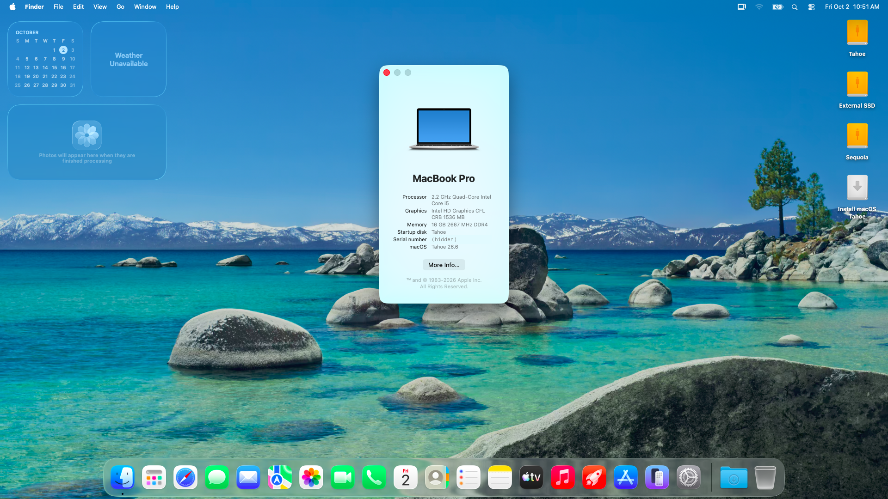

# HP EliteBook 840 G7 — macOS Tahoe OpenCore EFI

OpenCore EFI for the **HP EliteBook 840 G7** running **macOS Tahoe 26** (tested on 26.6, build 25G72). The same EFI also covers Sequoia 15. Every included kext supports both versions, and the OS-specific Wi-Fi kexts are limited with `MinKernel`.

## Hardware

| Component | Details |
|---|---|
| CPU | Intel Core i5-10310U (Comet Lake) |
| iGPU | Intel UHD 620 (`0x9B41`), spoofed to `0x3E9B`, platform-id `0x3EA50009` |
| USB | Comet Lake PCH-LP XHCI (`0x02ED`) + Titan Ridge Thunderbolt XHCI (`0x15EC`) |
| Wi-Fi / BT | Intel (AirportItlwm / IntelBluetoothFirmware) |
| Audio | `layout-id` 21 |
| SMBIOS | `MacBookPro16,2` |

## Software

- **OpenCore 1.0.8** (RELEASE)
- Lilu 1.7.2, VirtualSMC 1.3.8, WhateverGreen 1.7.1, AppleALC 1.9.8, RestrictEvents 1.1.6
- VoodooPS2Controller 2.3.8, VoodooI2C 2.9.1 + VoodooI2CHID
- AirportItlwm 2.3.0 + IO80211FamilyLegacy + IOSkywalkFamily (downgrade), AMFIPass 1.4.1
- IntelBluetoothFirmware / IntelBTPatcher 2.5.0, BlueToolFixup 2.7.2
- ECEnabler, BrightnessKeys, NVMeFix, SMCBatteryManager, SMCProcessor, SMCLightSensor
- USBMap.kext: a USBToolBox map using the native `AppleUSBHostMergeProperties` class
- SIP partly disabled (`csr-active-config` = `0x00000A03`) and `SecureBootModel` = `Disabled`. The Wi-Fi root patch needs both.
- boot-args: `-v keepsyms=1 -igfxblt -vi2c-force-polling swd_panic=1 -ibtcompatbeta -lilubetaall -amfipassbeta amfi=0x80`

## Before you boot: generate your own SMBIOS

The serial number, MLB, ROM and system UUID in `config.plist` are **intentionally blank**. Generate a `MacBookPro16,2` SMBIOS with [GenSMBIOS](https://github.com/corpnewt/GenSMBIOS), then fill in `PlatformInfo → Generic`:

- `SystemSerialNumber`, `MLB`, `SystemUUID`
- `ROM`: your network adapter's MAC address (6 bytes)

## Tahoe-specific notes

### USB map keys (the main fix)
macOS Tahoe identifies USB ports with **new property keys**. A map that has only the old keys is ignored. Because `SSDT-USB-Reset` disables `XHC.RHUB`, the result is no USB ports at all and **"Still waiting for root device"** in the installer.

Each port in `USBMap.kext` therefore carries both key sets:

| Older macOS | Tahoe | Type |
|---|---|---|
| `port` | `usb-port-number` | Data |
| `UsbConnector` | `usb-port-type` | Number |

Keeping both lets the same map work on Sequoia and earlier. If you remap with an older tool, add the Tahoe keys back.

### Other changes
- `XHCI-unsupported.kext` is **disabled**. The Comet Lake XHCI (`0x02ED`) is matched natively.
- The TXHC (Thunderbolt) personality matches on `pcidebug 5:0:0`, which can change with Thunderbolt state. To boot an installer or external drive, use the **USB-A ports**, which are on the main XHC.

### Installing
- **Use a full USB installer** made with `createinstallmedia`. Running `Install macOS Tahoe.app` from inside Sequoia to install onto another volume failed at the RAM-disk stage. `patchd` logged `MobileSoftwareUpdateErrorDomain 1015/1013 – could not retrieve update path` and the laptop rebooted every time.
- **Reset NVRAM** from the OpenCore picker before installing if earlier attempts failed. Stale installer state in NVRAM was flagged as "inconsistent" by the installer.
- Expect one to three automatic reboots into "macOS Installer".

## Status

| Feature | Status |
|---|---|
| Boots to Tahoe desktop | ✅ (26.6) |
| Installer from USB | ✅ |
| iGPU | ✅ Framebuffer loads (1536 MB); Metal not yet verified |
| Wi-Fi | ✅ After the OCLP-X root patch plus `amfi=0x80` (see below) |
| Internal audio | ✅ After the OCLP-X root patch plus `amfi=0x80` (see below) |
| Bluetooth | ✅ Tested with an Apple Magic Mouse (USB-C) |
| Sleep, trackpad gestures | Not yet verified on Tahoe |

### Post-install root patch (Wi-Fi + audio)
Neither works on a fresh Tahoe install:
- **Audio:** Apple removed `AppleHDA.kext` in Tahoe, so AppleALC has nothing to patch.
- **Wi-Fi:** AirportItlwm needs the Ventura `IO80211` stack restored.

Both are fixed with [OCLP-X](https://github.com/JeoJay127/OCLP-X/releases) v2.7.0. ([OCLP-Mod](https://github.com/laobamac/OCLP-Mod) was archived in June 2026.)

1. Boot Tahoe and get internet (USB tethering or Ethernet). OCLP-X downloads a Kernel Debug Kit.
2. Run **Post-Install Root Patch**. It applies:
   - **Modern Audio:** `AppleHDA.kext` (from 26.0 Beta 1)
   - **Modern Wireless:** `IO80211.framework`, `WiFiPeerToPeer.framework` and `wifip2pd` (from 13.7.2)
3. **Add `amfi=0x80` to boot-args before rebooting.** This EFI already includes it.

> **Without `amfi=0x80`, Tahoe won't boot after the root patch.** AMFI rejects the patched ad-hoc-signed Wi-Fi frameworks (`code signature validation failed` for `IO80211`, `WiFiPeerToPeer`, `LibSystemShim.dylib`) even with AMFIPass 1.4.1 and `-amfipassbeta`. The boot then hangs at `(enable-swap)`, or reboots if `debug=0x100` isn't set. `amfi=0x80` relaxes AMFI so the patched files load. It can affect some apps' permission prompts (camera, microphone).

Re-run the root patch after every macOS update, because updates remove it.

## Debugging

For logs, swap in the OpenCore **DEBUG** binaries (OpenCore.efi, BOOTx64.efi and the OpenCore drivers, from the same release). Then set:

- `Misc → Debug → Target` = `67`, `AppleDebug` / `ApplePanic` = `true`
- add `-v debug=0x100` to boot-args

Logs are written to the root of the EFI partition (`opencore-*.txt`).

## Credits

[Acidanthera](https://github.com/acidanthera) (OpenCore, Lilu and plugins), [OpenIntelWireless](https://github.com/OpenIntelWireless), [VoodooI2C](https://github.com/VoodooI2C), [USBToolBox](https://github.com/USBToolBox), [CorpNewt](https://github.com/corpnewt) (SSDTTime, GenSMBIOS), and the [Dortania guide](https://dortania.github.io/OpenCore-Install-Guide/).
